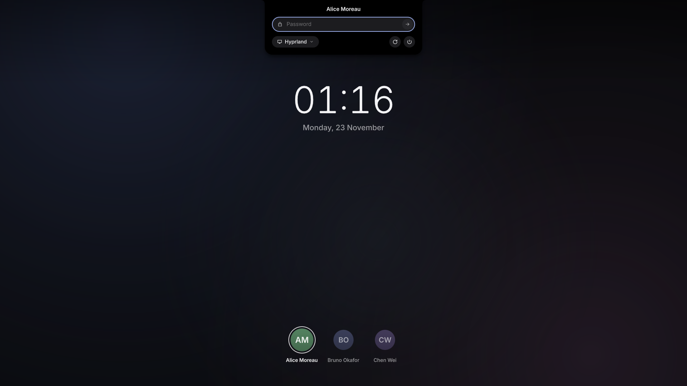
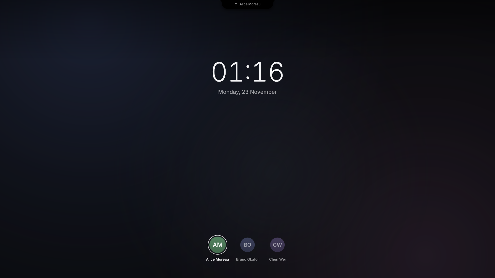
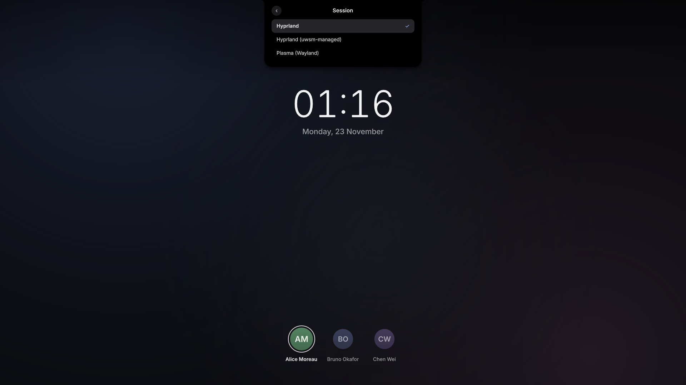
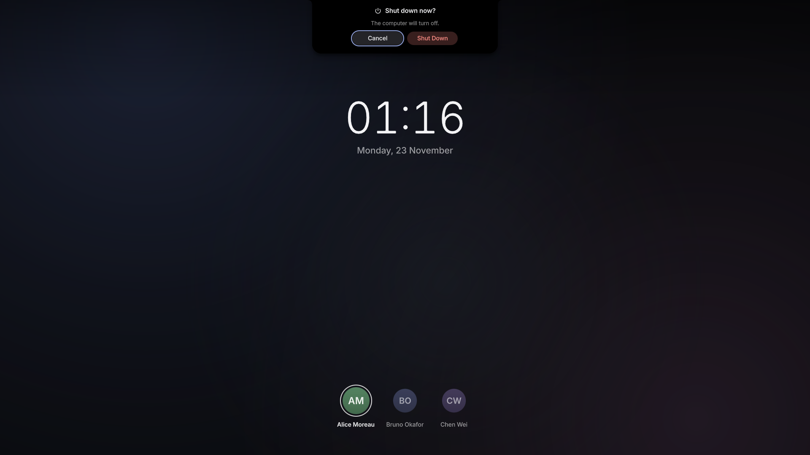

# Sumi SDDM

Un tema de inicio de sesión para **SDDM** (Qt 6), minimalista y oscuro. Todo gira en torno a **Login Edge**, un panel
en el borde superior de la pantalla: está recogido mientras no lo usas y se despliega en cuanto empiezas a escribir.



| Login Edge recogido | Elegir sesión | Confirmar apagado |
|---|---|---|
|  |  |  |

## Qué ofrece

- **Escribe y entra.** Desde Login Edge recogido, la primera tecla la despliega y ya escribe en el campo de
  contraseña. Intro inicia sesión.
- **Todo a mano, sin ventanas.** Sesión (Hyprland, Plasma…), reiniciar y apagar viven dentro de Login Edge.
  Apagar y reiniciar piden confirmación, y *Cancelar* tiene el foco por defecto.
- **Varios usuarios**, con avatar o iniciales, y un selector en la parte inferior.
- **Muy configurable** (41 opciones): fondo o wallpaper con desenfoque, colores, tipografía, escala, tamaño de
  Login Edge, formato del reloj, animaciones, varios monitores… Lista completa en [docs/CONFIG.md](docs/CONFIG.md).
- **Una configuración rota nunca te deja fuera.** Al configurar se valida todo de forma estricta. En la pantalla
  de inicio, un valor que no se entiende vuelve a su valor por defecto.
- **Se usa entera con el teclado** y es accesible: cada control tiene rol y nombre para lectores de pantalla.
- **Una ventana para configurarlo** (opcional): «Sumi Settings», con vista previa y botón para aplicar,
  en cualquier escritorio (ver [La ventana de ajustes](#la-ventana-de-ajustes)).
- **Independiente.** No necesita Quickshell, Hyprland ni nada más. Si usas Sumi Shell, sus ajustes incluyen
  una página para configurarlo (ver [Integración](#integración-con-sumi-shell)).

## Requisitos

- SDDM ≥ 0.21 con el greeter de **Qt 6** (`sddm-greeter-qt6`).
- `qt6-declarative`, `python`, `polkit`, `util-linux`, `systemd`.
- Opcional: `qt6-imageformats`, para wallpapers en WebP.
- Opcional, sólo para la ventana de ajustes: `pyside6`.

El paquete está pensado para **Arch Linux y derivadas** (CachyOS, EndeavourOS…). Si usas otra distribución,
mira [Otras distribuciones](#otras-distribuciones).

## Instalación (Arch Linux)

```sh
git clone https://github.com/kitasael-burakku/Sumi-Sddm.git
cd Sumi-Sddm

# Construir los paquetes (hace falta pyside6 para construir; el tema instalado no lo necesita).
cd packaging/arch && makepkg
# El tema, el helper y el comando `sumi-sddm`. NO activa el tema.
sudo pacman -U sumi-sddm-0*.pkg.tar.zst
# Opcional: la ventana de ajustes «Sumi Settings».
sudo pacman -U sumi-sddm-editor-*.pkg.tar.zst
```

Sin el paquete (o para desarrollar), `tools/sumi-sddm install --user` instala sólo el comando en `~/.local/bin`,
sin root; si va antes en tu `PATH`, gana a `/usr/bin/sumi-sddm`.

### Probarlo antes de activarlo

Nada de esto cambia tu pantalla de inicio:

```sh
sumi-sddm preview          # genera una captura PNG con tu configuración (~/.cache/sumi-sddm/preview/)
sumi-sddm try --yes        # abre el tema en una ventana de prueba (captura el teclado mientras está abierta)
```

### Activarlo

```sh
sumi-sddm system apply     # copia tu configuración y tu wallpaper al tema instalado (pide tu contraseña)
sumi-sddm system activate  # Sumi será tu pantalla de inicio la PRÓXIMA vez que aparezca
sumi-sddm system status    # comprueba qué está instalado, qué tema está activo y si tu configuración está al día
```

Para volver al tema anterior: `sumi-sddm system deactivate`.

Estas órdenes usan un pequeño helper con privilegios (`/usr/lib/sumi-sddm/sumi-sddm-helper`) a través de
polkit: piden tu contraseña cada vez y guardan una copia de seguridad antes de tocar `/etc/sddm.conf`.

## Si algo sale mal

Si la pantalla de inicio no responde, **no hace falta reinstalar nada**:

1. Pulsa **Ctrl+Alt+F3** y entra con tu usuario en la consola de texto.
2. Ejecuta `sudo /usr/lib/sumi-sddm/sumi-sddm-helper deactivate`. Esto repone el tema que tenías antes.
3. Vuelve a la pantalla gráfica con **Ctrl+Alt+F1** (o F2/F7).

Guía completa, incluida la forma de hacerlo a mano sin el helper: [docs/RECUPERACION.md](docs/RECUPERACION.md).

## Personalizar

Tu configuración vive en `~/.config/sumi-sddm/` y nunca se aplica sola. Primero la editas y después la llevas
al sistema con `sumi-sddm system apply`.

```sh
sumi-sddm config show                                   # valores actuales (* = cambiado por ti)
sumi-sddm config set clockFormat=12h accentColor=#ffb38a   # valida todo o no escribe nada
sumi-sddm config unset clockFormat                      # vuelve al valor por defecto
sumi-sddm config edit                                   # abre $EDITOR con todas las opciones comentadas
sumi-sddm wallpaper set ~/Imágenes/fondo.jpg            # usar una imagen de fondo (también: clear, info)
sumi-sddm avatar set ~/Imágenes/yo.png                  # tu foto de usuario
sumi-sddm config fonts                                  # tipografías instaladas que puede usar la pantalla de inicio
```

Las opciones se agrupan en: **fondo, colores, tipografía y escala, Login Edge, reloj, selector de usuarios, energía,
movimiento y comportamiento**. Cada una, con su rango y su valor por defecto, está en [docs/CONFIG.md](docs/CONFIG.md).

> SDDM se ejecuta como el usuario `sddm`, que no puede leer tu carpeta personal. Por eso `system apply` copia el
> wallpaper dentro del tema instalado en lugar de enlazarlo, y las tipografías instaladas sólo en tu `$HOME` no
> sirven (`config fonts` las marca con `~`).

## La ventana de ajustes

El paquete opcional `sumi-sddm-editor` añade **Sumi Settings** al menú de aplicaciones (o
`sumi-sddm-editor` desde una terminal). Es lo mismo que `sumi-sddm config`, pero con un formulario por grupos,
búsqueda, vista previa al momento, selector de tipografías (marca las que el greeter no puede ver), tu avatar y
una página **Login screen** para aplicar, activar o volver al tema anterior; cada una de esas tres pide la
contraseña de un administrador. Sigue el tema claro u oscuro del sistema, se usa entera con el teclado y no
corre nunca como root: todo lo hace la orden `sumi-sddm`.

La barra lateral aparece desde 780 px lógicos. En ventanas más estrechas puedes cambiar de sección con el
selector junto a la búsqueda. Desde 1180 px lógicos, la vista previa se acopla a la derecha y se puede
expandir. En una ventana más estrecha, **Preview** la abre en el área central. Usa Ctrl+F para buscar por
nombre o clave y Tab para recorrer los controles. Si el entorno no le comunica a Qt la preferencia de
movimiento reducido, puedes iniciar el editor con `SUMI_SETTINGS_REDUCE_MOTION=1`.

Puede estar abierta a la vez que la terminal o que los ajustes de Sumi Shell: si algo cambia por otro lado, lo
avisa y recarga en vez de pisarlo.

## Teclado

| Dónde | Tecla | Acción |
|---|---|---|
| Login Edge recogido | cualquier carácter | la despliega y escribe el carácter en el campo |
| | Intro / Espacio / ↓ | la despliega |
| Campo de contraseña | Intro | iniciar sesión |
| | Esc | borra lo escrito; con el campo vacío, recoge Login Edge |
| Cualquier sitio | Tab / Mayús+Tab | contraseña → sesión → reiniciar → apagar → usuarios |
| Selector de usuarios | ← / → | cambia de usuario (borra la contraseña escrita) |
| | Intro / Espacio | vuelve al campo |
| | cualquier carácter | lo escribe en la contraseña |
| Lista de sesiones | ↑ / ↓, Intro | elegir · Esc: volver sin cambiar |
| Confirmación de energía | ← / →, Intro | Cancelar tiene el foco por defecto · Esc: cancelar |

## Integración con Sumi Shell

Sumi SDDM funciona solo, pero si usas **Sumi Shell** (el escritorio Quickshell del mismo autor), en
*Settings → Desktop tools → Login screen* puedes cambiar el wallpaper, los colores y el resto de opciones con
vista previa, y aplicarlas sin abrir una terminal. Por debajo usa `sumi-sddm` con su salida `--json`, cuyo
contrato está en [docs/CLI-JSON.md](docs/CLI-JSON.md). El código está en [integration/sumi-shell/](integration/sumi-shell/).

## Otras distribuciones

El tema en sí es QML puro y debería funcionar con cualquier SDDM ≥ 0.21 con Qt 6. Para instalarlo a mano:

```sh
sudo cp -r theme/sumi /usr/share/sddm/themes/sumi
```

Después pon `Current=sumi` en la sección `[Theme]` de **`/etc/sddm.conf`**. SDDM lee ese archivo el último, así
que un archivo en `/etc/sddm.conf.d/` no basta si `/etc/sddm.conf` ya define un tema. Las órdenes
`sumi-sddm system …` y el helper esperan las rutas del paquete de Arch. Sin ellos, copia tu
`~/.config/sumi-sddm/theme.conf.user` a la carpeta del tema.

## Desarrollo

```sh
tools/sumi-sddm check                # validación del esquema + lint + todas las pruebas (Python y QML) + humo
tools/sumi-sddm render --size all    # capturas de todos los escenarios y resoluciones en tests/out/
tools/sumi-sddm gen                  # regenerar theme.conf, schema.js y CONFIG.md tras editar el esquema
editor/sumi-sddm-editor              # la ventana de ajustes desde el repositorio (usa `sumi-sddm` del PATH)
```

La prueba de humo (`smoke`) carga el tema en el greeter real (`sddm-greeter-qt6 --test-mode`, sin pantalla) y
comprueba que lee exactamente la configuración esperada. En `--test-mode` no se autentica ni se apaga de verdad.

<details>
<summary>Estructura del repositorio</summary>

```
schema/config-schema.json  fuente única de la configuración (claves, tipos, rangos, defaults, etiquetas de UI)
theme/sumi/                lo que se instala en /usr/share/sddm/themes/sumi
  metadata.desktop         QtVersion=6, ConfigFile=theme.conf
  theme.conf               defaults documentados (GENERADO desde el esquema)
  Main.qml                 adaptador: contexto de SDDM → propiedades de Greeter
  components/              Greeter, Style, Notch, NotchShape, Background, Clock, UserStrip, Avatar, controles
    config.js              lectura tolerante (paridad con tools/sumiconf/schema.py)
    schema.js              GENERADO desde el esquema
  assets/fonts/            Inter 4 sin modificar + OFL.txt
VERSION                    versión del proyecto (única fuente)
tools/sumi-sddm            CLI sin privilegios: config, wallpaper, avatar, preview, try, system, install --user, gen…
tools/sumiconf/            esquema, validación estricta/tolerante, INI de QSettings, imágenes, rutas, bloqueo
tools/harness/             dobles de SDDM y Render.qml (vista previa y capturas)
system/                    helper privilegiado (pkexec) y su acción de polkit
editor/                    Sumi Settings (PySide6 + Qt Quick Controls): componentes QML y backend de la CLI
packaging/arch/            PKGBUILD dividido: sumi-sddm (tema, helper, CLI) y sumi-sddm-editor; no activa nada
integration/sumi-shell/    página Login screen para los ajustes de Sumi Shell
tests/                     pruebas Python y QML, y casos compartidos entre ambos
docs/                      configuración, contrato JSON, recuperación e informes de cada fase del desarrollo
```

</details>

Historial del desarrollo, desde la auditoría inicial hasta las pruebas en real: `docs/FASE1-AUDITORIA.md` a
[docs/FASE6-PRUEBAS.md](docs/FASE6-PRUEBAS.md).

## Licencia

Sumi SDDM se distribuye bajo la licencia [MIT](LICENSE). Incluye la tipografía Inter, con licencia SIL Open Font
License 1.1 ([OFL.txt](theme/sumi/assets/fonts/OFL.txt)). Los iconos y el fondo por defecto están dibujados en el
propio QML del tema.
